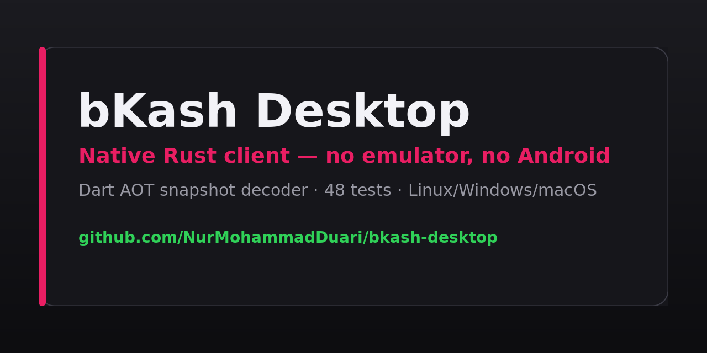

<div align="center">



# bKash Desktop

### Run bKash on your PC — natively, in Rust. No emulator. No Android.

[](https://github.com/NurMohammadDuari/bkash-desktop/actions/workflows/ci.yml)
[](https://www.rust-lang.org/)
[](LICENSE)
[](https://www.linuxfoundation.org/)
[](https://www.microsoft.com/windows)
[](https://www.apple.com/macos/)
[](Cargo.toml)
[](https://github.com/NurMohammadDuari/bkash-desktop/actions/workflows/ci.yml)

[Quick start](#quick-start) · [What it is](#what-it-is) · [Screens](#screens) · [Tools](#the-tools) · [Status](#status--the-honest-table) · [Docs](#documentation) · [Contributing](#contributing)

---

## Why does this exist?

bKash's Android app is a **Flutter app**. Its entire UI and business logic is compiled to ARM64 machine code inside a 30 MB Dart AOT snapshot (`libapp.so`), wrapped in a Java shell of exactly three files:

```java
package com.bKash.customerapp;

public final class MainActivity extends FlutterFragmentActivity {
    @Override public void onCreate(@Nullable Bundle savedInstanceState) {
        super.onCreate(savedInstanceState);
    }
}
```

There is no Kotlin to port. Decompiling the APK yields 26,234 Java files and one three-line entry point.

Every other route to running an Android banking app on a desktop — emulators, Android Studio VMs, cloud device farms, Windows Subsystem for Android — puts a full Android runtime between you and the app. **This project puts none.** The binary you run is a native ELF/PE/Mach-O executable.

## Quick start

**Requirements:** Rust 1.75+ and a GPU with OpenGL 3.3 or Vulkan.

```bash
git clone https://github.com/NurMohammadDuari/bkash-desktop
cd bkash-desktop
cargo build --release
./target/release/bkash_desktop
```

A window opens. Enter any 11-digit Bangladeshi mobile number, press **Send OTP**, and the demo OTP appears on screen. Enter it, press **Verify**, and you land on a working account screen with balance, send money, cash out and history.

## Screens

| | |
|---|---|
| **Sign in** — mobile → OTP → verify | **Account** — balance, actions, recent activity |
| **Send money** — recipient + amount, Tk 100,000 guard | **History** — full transaction list with `trx_id` |

## What it is

bKash ships as a Flutter app, so there is no Kotlin source to port — the logic is machine code. This project recovers what *is* recoverable from the shipped artifact and rebuilds it natively in Rust:

| Layer | Status |
|---|---|
| Dart AOT snapshot decoder (ELF64 + snapshot header) | **Done** — cross-validated against Ghidra |
| Crypto scheme (AES-256-CBC/PKCS#7, RSA-OAEP-SHA256) | **Done** — 8 unit tests |
| API surface recovery (7 gateways, 33 endpoints) | **Done** — extracted from the string pool |
| Architecture recovery (119 screens, 564 bloc states, 742 i18n keys) | **Done** — automated inventory |
| Native desktop GUI (egui) | **Done** — runs, verified on screen |
| Live authenticated session | **Not implemented** — see below |

## The tools

Two more binaries ship alongside the GUI, both usable standalone:

```bash
# Decode the Dart AOT payload — 30 MB in 0.37s, pure Rust, no Java, no Ghidra
bkanalyze libapp.so --urls --features --json features.json

# Inspect the recovered API surface
bknative endpoints
bknative envelope 01712345678 123456      # dry-run: prints what would be sent
```

`bkanalyze` exists because Ghidra does not work on this file: a stripped Dart AOT snapshot ships no symbols and a 62-byte `.eh_frame`, so Ghidra 12.1.4 recovered **0 procedures** across 21 MB of `.text` and **53 strings**. The dependency-free Rust ELF reader gets all four snapshot sections, the header, the snapshot hash, 43,955 printable runs and 230 absolute URLs.

## Why it is built this way

- **Zero Android dependencies at runtime.** `bkanalyze` is a pure Rust ELF reader — no JADX, no Ghidra, no Python.
- **Every constant is traceable.** Each gateway URL, endpoint and crypto marker in `src/domain.rs` and `src/crypto.rs` was recovered from the shipped artifact. Where something *is* inferred, the comment says so.
- **Testable without a network.** The backend is a trait. The simulated backend and all 48 tests run offline; the HTTP client is the only piece that knows about sockets.
- **Money is never a float.** `Bdt` is a newtype over `i64` with checked arithmetic.

## Status — the honest table

| Layer | Status | Detail |
|---|---|---|
| Dart AOT snapshot decoding | ✅ Done | Cross-validated against an independent Ghidra read |
| Crypto scheme | ✅ Done | AES-256-CBC/PKCS#7 and RSA-OAEP-SHA256 |
| API surface recovery | ✅ Done | 7 gateways, 33 endpoints |
| Architecture recovery | ✅ Done | 119 screens, 564 bloc states, 742 i18n keys |
| Desktop GUI | ✅ Done | Login, balance, send money, cash out, history |
| Screen implementation | ❌ Not ported | Recovered as *names*; layout must be rebuilt by hand |
| Live authenticated session | ❌ Not implemented | Blocked by a third-party signing dependency |

**Why live auth is not implemented.** Ghidra decoding of `libsecurity_lite.so` shows it is **Alipay SecurityGuard Lite**, exporting `signRequest`, `encrypt` and `decrypt` over JNI. Sensitive requests are signed by proprietary native code whose *verifier* lives on Alipay's servers — it is not in the APK. That is a cryptographic dependency on a third party, not a gap a capture could close. `libtoolChecker.so`, meanwhile, is the open-source **RootBeer** root detector.

Full detail in [`docs/PORT-NOTES.md`](docs/PORT-NOTES.md).

## Documentation

- [**Architecture**](docs/ARCHITECTURE.md) — how every module fits together
- [**Reverse-engineering notes**](docs/ANALYSIS.md) — what the artifact contained
- [**Port status**](docs/PORT-NOTES.md) — what is ported and what is not, honestly
- [**Landing page**](web/index.html) — SEO site for the project

## Security

The project stores no credentials and ships offline by default. It will not bypass device attestation, root detection, or emulator detection on any third-party application. See [SECURITY.md](SECURITY.md).

## Legal

This project contains **no bKash code or assets**. It is an independent reimplementation produced by static analysis of a publicly obtainable APK, for research and interoperability purposes. It is not affiliated with, endorsed by, or connected to bKash or any related company. It ships with an offline simulated backend by default and performs no live financial transactions. See [LICENSE](LICENSE).

## Contributing

Contributions welcome — see [CONTRIBUTING.md](CONTRIBUTING.md). The highest-value PRs are ones that replace an *inferred* value with an *observed* one. The one rule: never label something observed unless you observed it.

## Related searches

`bkash for pc` · `bkash linux` · `bkash windows` · `run bkash without emulator` · `flutter reverse engineering` · `dart aot snapshot decoder` · `rust egui desktop app` · `elf parser rust` · `bangladesh mobile banking`

---

<div align="center">
<sub>MIT licensed · Built with Rust, egui, and a lot of reading hex.</sub>
</div>